# 🧪 원소 퀴즈 게임 (Python · 클래스 · JSON · Git)

> Windows 11 + WSL(Ubuntu) 환경에서 Python 표준 라이브러리만으로 **터미널 퀴즈 게임**을 처음부터 끝까지 만들고,
> 기능 하나를 완성할 때마다 Git으로 커밋하며 **명령어와 실행 결과**로 동작을 검증한 기록입니다.

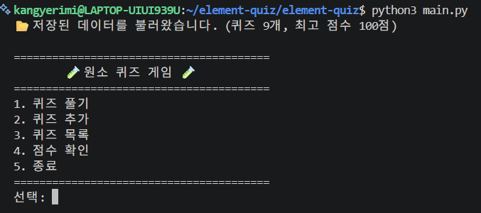

> 📸 **증빙:** 재실행 시 `📂 저장된 데이터를 불러왔습니다. (퀴즈 9개, 최고 점수 …)` + 메뉴 출력 (요구사항: 메뉴 출력, 데이터 유지)

---

## 목차

1. [프로젝트 개요](#1-프로젝트-개요)
2. [퀴즈 주제와 선정 이유](#2-퀴즈-주제와-선정-이유)
3. [실행 환경](#3-실행-환경)
4. [실행 방법](#4-실행-방법)
5. [수행 체크리스트](#5-수행-체크리스트)
6. [파일 구조](#6-파일-구조)
7. [개발 과정 한눈에 보기](#7-개발-과정-한눈에-보기)
8. [개발 환경 구축 (WSL · Git)](#8-개발-환경-구축-wsl--git)
9. [Git 저장소 설정과 첫 커밋](#9-git-저장소-설정과-첫-커밋)
10. [메뉴 기능](#10-메뉴-기능)
11. [공통 입력 · 예외 처리](#11-공통-입력--예외-처리)
12. [Quiz 클래스와 기본 퀴즈 데이터](#12-quiz-클래스와-기본-퀴즈-데이터)
13. [퀴즈 풀기 (브랜치 생성 · 병합)](#13-퀴즈-풀기-브랜치-생성--병합)
14. [파일 저장 / 불러오기 (state.json)](#14-파일-저장--불러오기-statejson)
15. [퀴즈 추가](#15-퀴즈-추가)
16. [퀴즈 목록](#16-퀴즈-목록)
17. [점수 확인 (최고 점수)](#17-점수-확인-최고-점수)
18. [QuizGame 클래스로 구조 정리 (리팩터링)](#18-quizgame-클래스로-구조-정리-리팩터링)
19. [clone · pull 실습](#19-clone--pull-실습)
20. [Git 작업 기록](#20-git-작업-기록)
21. [트러블슈팅](#21-트러블슈팅)
22. [검증 방법 요약](#22-검증-방법-요약)
23. [개념 정리](#23-개념-정리)
24. [유지보수 가이드 (요구 변경 시 수정 위치)](#24-유지보수-가이드-요구-변경-시-수정-위치)
25. [배운 점과 향후 개선](#25-배운-점과-향후-개선)
26. [평가 피드백 반영 내역](#26-평가-피드백-반영-내역)

---

## 1. 프로젝트 개요

**미션 목표:** 문법을 아는 것을 넘어, **동작하는 프로그램 하나를 처음부터 끝까지 완성**하고 그 과정을 Git으로 기록한다.

| 영역 | 한 일 |
|---|---|
| 게임 기능 | 메뉴에서 번호를 골라 **퀴즈 풀기 / 퀴즈 추가 / 퀴즈 목록 / 점수 확인 / 종료** |
| 입력·예외 처리 | 공백 제거, 문자·범위 밖 숫자·빈 입력 재입력, `Ctrl+C`·`EOF` 안전 종료, 저장 파일 손상 복구 |
| 객체 지향 | `Quiz`(퀴즈 한 문제), `QuizGame`(게임 전체 관리) **두 개의 클래스**로 역할 분리 |
| 데이터 영속성 | 퀴즈와 최고 점수를 `state.json`(UTF-8)에 저장 → 껐다 켜도 유지 |
| Git/GitHub | 기능 단위 커밋 **20개**, `feature/play-quiz` 브랜치 생성·병합, clone·pull 실습, 7종 명령어 모두 사용 |

외부 라이브러리 없이 Python 기본 문법과 표준 라이브러리(`json`, `os`, `shutil`)만 사용했습니다.

---

## 2. 퀴즈 주제와 선정 이유

**주제: 원소 (원소 기호 · 원자 번호 · 원소의 특징)**

원소에 푹 빠져 있는 아들을 위해 만들었습니다.
아들이 좋아하는 원소 이야기를 퀴즈로 함께 풀면서 원소 기호와 특징을 재미있게 익힐 수 있도록 하고 싶었습니다.
퀴즈 추가 기능이 있어서 아들이 직접 문제를 만들어 넣을 수도 있습니다.

문제는 세 가지 유형을 골고루 섞었습니다.

| 유형 | 예시 |
|---|---|
| 원소 기호 → 이름 | 원소 기호 `Fe`는 어떤 원소일까요? → 철 |
| 원자 번호 | 원자 번호 1번, 우주에서 가장 많고 가장 가벼운 원소는? → 수소 |
| 특징 | 실온에서 유일하게 액체 상태인 금속 원소는? → 수은 |

---

## 3. 실행 환경

| 항목 | 값 |
|---|---|
| OS | Windows 11 |
| Linux 환경 | WSL2 + Ubuntu |
| 쉘 | **bash (WSL Ubuntu)** — 모든 개발·Git 작업 |
| Python | Python 3.14.4 (Ubuntu 내장 `python3`) |
| Git | git version 2.53.0 (Ubuntu) |
| GitHub 인증 | GitHub CLI `gh` (브라우저 로그인) |
| 에디터 | Visual Studio Code + WSL 확장 + Python 확장 |
| 외부 라이브러리 | 없음 (표준 라이브러리 `json`, `os`, `shutil`만 사용) |

> 💡 수업 요구에 따라 PowerShell이 아닌 **리눅스(WSL Ubuntu) 환경**에서 진행했습니다.
> 윈도우에 설치한 Python·Git과 우분투 안의 Python·Git은 **서로 별개**라서, 우분투 안에서 버전 확인과 Git 설정을 다시 했습니다.

개발 환경 화면 (VSCode 왼쪽 아래 `WSL: Ubuntu` 연결, 터미널에서 버전·Git 설정 확인):

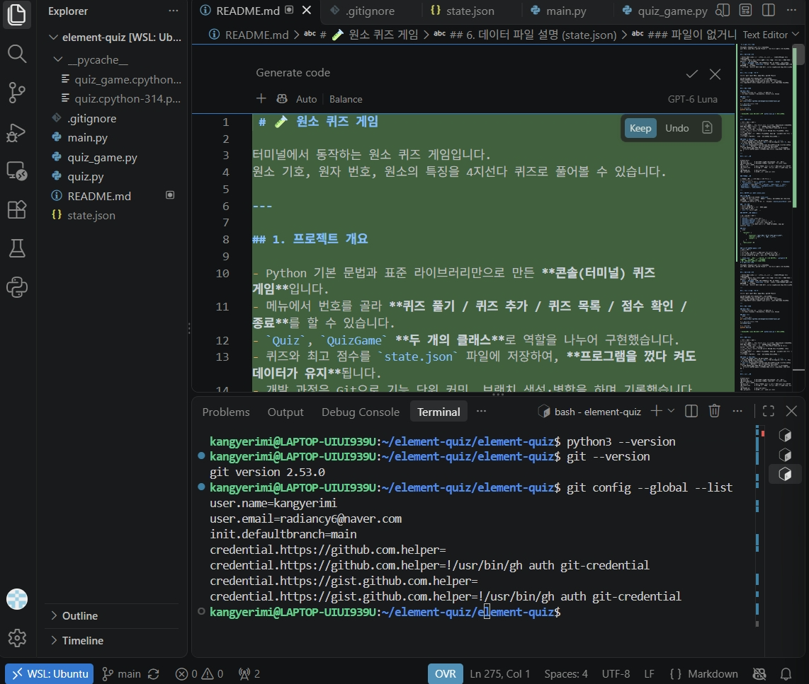

> 📸 **증빙:** VSCode가 `WSL: Ubuntu`에 연결된 상태, `python3 --version`, `git --version`, `git config --global --list` 결과 (제출물: 개발 환경 설정)

---

## 4. 실행 방법

```bash
# 1. 저장소 복제
git clone https://github.com/kangyerimi/element-quiz.git

# 2. 프로젝트 폴더로 이동
cd element-quiz

# 3. 게임 실행
python3 main.py
```

- Python **3.10 이상**이면 실행됩니다. 설치할 외부 패키지는 없습니다.
- Windows에서 직접 실행할 때는 `python main.py`로 실행합니다.
- 처음 실행하면 `state.json`이 없으므로 **기본 원소 퀴즈 8개**로 시작하고, 종료할 때 `state.json`이 자동으로 만들어집니다.

---

## 5. 수행 체크리스트

**게임 기능**
- [x] [메뉴 출력 · 선택 · 종료 · 잘못된 입력 처리](#10-메뉴-기능)
- [x] [공통 입력/예외 처리](#11-공통-입력--예외-처리) (공백 제거, `abc`, 범위 밖, 빈 입력, `Ctrl+C`, `EOF`)
- [x] [Quiz 클래스](#12-quiz-클래스와-기본-퀴즈-데이터) (문제·선택지 4개·정답 1~4, 출력·정답 확인 메서드)
- [x] [기본 퀴즈 5개 이상](#12-quiz-클래스와-기본-퀴즈-데이터) (기본 8개 + 직접 추가 1개 = 9개)
- [x] [퀴즈 풀기](#13-퀴즈-풀기-브랜치-생성--병합) (출제, 정답/오답, 결과, 퀴즈 없음 처리)
- [x] [퀴즈 추가](#15-퀴즈-추가) (입력 검증 + 파일 저장)
- [x] [퀴즈 목록](#16-퀴즈-목록) (퀴즈 없음 처리)
- [x] [점수 확인](#17-점수-확인-최고-점수) (최고 점수 비교·갱신·저장, 기록 없음 처리)
- [x] [QuizGame 클래스](#18-quizgame-클래스로-구조-정리-리팩터링) (퀴즈 목록·최고 점수 속성, 기능별 메서드)
- [x] [state.json 저장/불러오기](#14-파일-저장--불러오기-statejson) (UTF-8, 파일 없음·손상·권한 오류 처리, 손상 파일 백업, 안전 저장)
- [x] [대용량(1000개 이상) 성능 측정](#147-대용량1000개-이상-분석과-저장-형식-비교)
- [x] [요구 변경 시 수정 위치 가이드](#24-유지보수-가이드-요구-변경-시-수정-위치)

**Git / GitHub**
- [x] [GitHub 저장소 생성 + `.gitignore`, `README.md` + 첫 commit/push](#9-git-저장소-설정과-첫-커밋)
- [x] [의미 있는 커밋 10개 이상](#20-git-작업-기록) (20개)
- [x] [브랜치 생성 및 병합](#13-퀴즈-풀기-브랜치-생성--병합) (`feature/play-quiz` → `main`)
- [x] [clone · pull 실습](#19-clone--pull-실습)
- [x] [Git 7종 명령어](#20-git-작업-기록) (`init`, `add`, `commit`, `push`, `pull`, `checkout`, `clone`)
- [x] [트러블슈팅 기록](#21-트러블슈팅) (8건)

---

## 6. 파일 구조

```
element-quiz/
├── main.py             # 프로그램 시작점: QuizGame을 만들고 run() 실행
├── quiz_game.py        # QuizGame 클래스: 메뉴, 입력 검사, 게임 기능, 저장/불러오기
├── quiz.py             # Quiz 클래스 + 기본 원소 퀴즈 8개(get_default_quizzes)
├── state.json          # 퀴즈·최고 점수 저장 파일 (실행 시 자동 생성, Git 제외)
├── state.json.bak      # 손상된 저장 파일을 복구하기 전에 남기는 백업 (손상 시에만 생성, Git 제외)
├── docs/
│   └── screenshots/    # README에 첨부한 실행 화면
├── README.md           # 기술 문서 (이 파일)
└── .gitignore          # Git에 올리지 않을 파일 목록
```

### 클래스 구조

| 클래스 | 역할 | 속성 | 메서드 |
|---|---|---|---|
| `Quiz` | 퀴즈 **한 문제** | `question`, `choices`, `answer` | `display()`, `is_correct()`, `to_dict()` |
| `QuizGame` | 게임 **전체 관리** | `quizzes`, `best_score` | 아래 표 참고 |

| `QuizGame` 메서드 묶음 | 메서드 |
|---|---|
| 입력 처리 | `get_number()`, `get_text()` |
| 저장/불러오기 | `load_state()`, `check_quiz_data()`, `save_state()`, `reset_to_default()`, `backup_broken_file()`, `print_permission_help()` |
| 화면·게임 기능 | `show_menu()`, `play_quiz()`, `update_best_score()`, `add_quiz()`, `show_quiz_list()`, `show_score()` |
| 실행 | `run()` |

### 예외가 났을 때 어느 클래스가 책임지나

| 상황 | 담당 | 메서드 |
|---|---|---|
| 잘못된 입력 (빈 입력, `abc`, 범위 밖) | `QuizGame` | `get_number()`, `get_text()` |
| 저장 파일 없음·손상·권한 오류 | `QuizGame` | `load_state()` → `backup_broken_file()`, `reset_to_default()`, `print_permission_help()` |
| 저장 파일 내용 형식 검증 | `QuizGame` | `check_quiz_data()` |
| 저장 실패 | `QuizGame` | `save_state()` |
| `Ctrl+C` / `EOF` | `QuizGame` | `run()` |
| 정답 판정 | `Quiz` | `is_correct()` — 이미 검증된 1~4 숫자만 받으므로 예외를 처리하지 않음 |

> 원칙: **검증과 복구는 `QuizGame`이 전부 맡고, `Quiz`는 검증을 통과한 데이터만 다룬다.**

### .gitignore

```
__pycache__/
*.pyc
.vscode/
state.json
state.json.bak
state.json.tmp
```

| 항목 | 제외한 이유 |
|---|---|
| `__pycache__/`, `*.pyc` | Python이 실행할 때 자동으로 만드는 임시 파일 |
| `.vscode/` | 개인 에디터 설정 |
| `state.json` | 실행할 때마다 바뀌는 개인 세이브 데이터. 처음 실행하면 자동 생성되므로 저장소에 올리지 않음 |
| `state.json.bak`, `state.json.tmp` | 손상 시 백업 파일, 저장 도중 쓰는 임시 파일 (개인 데이터) |

---

## 7. 개발 과정 한눈에 보기

기능을 작은 단위로 나누어 **만들기 → 실행해서 확인 → 커밋 → push**를 반복했습니다.

| 단계 | 한 일 | 커밋 |
|---|---|---|
| 0 | WSL Ubuntu 설치, Python·Git 확인, Git 사용자 설정, VSCode 연결 | — |
| 1 | 저장소 생성, `README.md`·`.gitignore`, 첫 push | `815229e` Chore: 프로젝트 초기 설정 |
| 2 | 메뉴 출력·선택·종료 | `92d85b7` Feat: 메뉴 출력 및 선택 기능 구현 |
| 3 | 숫자 입력 검사, `Ctrl+C`/`EOF` 처리 | `e9d1ffc` Feat: 숫자 입력 검증 및 Ctrl+C/EOF 예외 처리 추가 |
| 4 | `Quiz` 클래스 | `4f30599` Feat: Quiz 클래스 작성 |
| 5 | 기본 원소 퀴즈 8개 | `c0e9deb` Feat: 기본 원소 퀴즈 8개 추가 |
| 6 | **브랜치**에서 퀴즈 풀기 → `main`에 병합 | `742c4b7` Feat / `4530f60` Merge |
| 7 | `state.json` 저장·불러오기, 손상 처리 | `804a17c` Feat: state.json 저장/불러오기 |
| 8 | 퀴즈 추가 | `7c6f031` Feat: 퀴즈 추가 기능 구현 |
| 9 | 퀴즈 목록 | `6fa3f01` Feat: 퀴즈 목록 보기 기능 구현 |
| 10 | 최고 점수 확인·갱신 | `a9388b1` Feat: 최고 점수 확인 및 갱신 기능 구현 |
| 11 | `QuizGame` 클래스로 구조 정리 | `6029d62` Refactor: QuizGame 클래스로 게임 로직 분리 |
| 12 | README 작성 | `6971b3e` Docs: README 작성 |
| 13 | clone → 수정·push → pull 실습 | `106c97c` Docs: README에 clone/pull 실습 문장 추가 |
| 14 | 실행 화면 스크린샷 추가 | `7f3e728` Docs: README에 실행 화면 및 예외 처리 스크린샷 추가 |
| 15 | 최종 점검: 저장 경로 고정, 저장 데이터 형식 검사 | `88e14b8` Fix: state.json 경로를 프로젝트 루트로 고정하고 저장 데이터 형식 검사 추가 |
| 16 | README를 개발 과정 중심 기술 문서로 재작성 + 개발 환경 사진 | `529723d`, `84a1924` Docs: README를 개발 과정 중심 기술 문서로 재작성 |
| 17 | 평가 피드백 반영: 권한 오류 안내, 손상 파일 백업, 안전 저장 | Fix: 권한 오류 안내, 손상 파일 백업, 안전 저장 추가 |
| 18 | 평가 피드백 반영: README 보완 (흐름도, 대용량 측정, 유지보수 가이드 등) | Docs: 평가 피드백 반영하여 README 보완 |

> 💡 과제 문서 순서와 달리 **저장 기능(7단계)을 퀴즈 추가(8단계)보다 먼저** 만들었습니다.
> 추가한 퀴즈를 파일에 저장하려면 저장 기능이 먼저 있어야 하기 때문입니다.

---

## 8. 개발 환경 구축 (WSL · Git)

### 8.1 WSL Ubuntu 설치 (관리자 PowerShell)

```powershell
PS C:\WINDOWS\system32> wsl --install
요청한 작업을 수행하려면 권한 상승이 필요합니다.
다운로드 중: Linux용 Windows 하위 시스템 3.0.5
설치 중: Linux용 Windows 하위 시스템 3.0.5
Linux용 Windows 하위 시스템 3.0.5이(가) 설치되었습니다.
Windows 선택적 구성 요소 설치 중: VirtualMachinePlatform
...
요청한 작업이 잘 실행되었습니다. 시스템을 다시 시작하면 변경 사항이 적용됩니다.

PS C:\WINDOWS\system32> wsl --install -d Ubuntu
다운로드 중: Ubuntu
설치 중: Ubuntu
배포가 설치되었습니다. 'wsl.exe -d Ubuntu'을(를) 통해 시작할 수 있습니다.
Ubuntu 시작하는 중...
Create a default Unix user account: kangyerimi
New password:
Retype new password:
passwd: password updated successfully

kangyerimi@LAPTOP-UIUI939U:/mnt/c/WINDOWS/system32$
```

| 명령 | 의미 |
|---|---|
| `wsl --install` | 윈도우에 WSL 기능(리눅스를 돌리는 기능) 설치 → 재부팅 필요 |
| `wsl --install -d Ubuntu` | 배포판(`-d`)으로 Ubuntu를 내려받아 설치 |

> 💡 설치 직후 위치가 `/mnt/c/WINDOWS/system32`(윈도우 시스템 폴더)라서, `cd ~`로 **리눅스 홈 폴더**로 이동한 뒤 작업했습니다.

### 8.2 Ubuntu 업데이트와 도구 확인

```bash
kangyerimi@LAPTOP-UIUI939U:~$ sudo apt update
kangyerimi@LAPTOP-UIUI939U:~$ sudo apt upgrade -y
kangyerimi@LAPTOP-UIUI939U:~$ python3 --version
Python 3.14.4
kangyerimi@LAPTOP-UIUI939U:~$ git --version
git version 2.53.0
```

| 명령 | 의미 |
|---|---|
| `sudo` | 관리자 권한으로 실행 (그래서 비밀번호를 묻는다) |
| `apt update` / `apt upgrade -y` | 설치 가능한 프로그램 목록 갱신 / 실제 업데이트 (`-y`: 모두 예) |
| `python3 --version` | 우분투는 `python`이 아니라 **`python3`** 명령을 사용 |

### 8.3 Git 사용자 정보 및 기본 브랜치 설정

```bash
kangyerimi@LAPTOP-UIUI939U:~$ git config --global user.name "kangyerimi"
kangyerimi@LAPTOP-UIUI939U:~$ git config --global user.email "****@naver.com"
kangyerimi@LAPTOP-UIUI939U:~$ git config --global init.defaultBranch main
kangyerimi@LAPTOP-UIUI939U:~$ git config --global --list
user.name=kangyerimi
user.email=****@naver.com
init.defaultbranch=main
```

> 💡 `init.defaultBranch main`: 새 저장소의 기본 브랜치 이름을 GitHub와 같은 `main`으로 맞춤.
> 이메일은 GitHub 가입 이메일과 같아야 GitHub에서 내 커밋으로 인식됩니다. (README에서는 마스킹)

### 8.4 프로젝트 폴더 생성과 VSCode 연결

```bash
kangyerimi@LAPTOP-UIUI939U:~$ mkdir element-quiz
kangyerimi@LAPTOP-UIUI939U:~$ cd element-quiz
kangyerimi@LAPTOP-UIUI939U:~/element-quiz$ code .
```

- VSCode에 **WSL 확장**을 설치한 뒤 `code .`을 실행하면, VSCode가 우분투 폴더에 연결된 상태로 열립니다. (왼쪽 아래 `WSL: Ubuntu` 표시)
- 연결된 VSCode에 **Python 확장**을 한 번 더 설치했습니다. (윈도우 쪽과 우분투 쪽 확장은 별개)
- 실제 작업 폴더는 `~/element-quiz/element-quiz` 입니다. ([트러블슈팅 3](#트러블슈팅-3-폴더가-두-겹으로-생성됨) 참고)

---

## 9. Git 저장소 설정과 첫 커밋

GitHub에서 **README 없이** 빈 Public 저장소 `element-quiz`를 만든 뒤, 로컬에서 `README.md`, `.gitignore`를 만들고 연결했습니다.
(GitHub에서 README를 만들면 로컬과 기록이 달라져 첫 push가 충돌하기 때문)

```bash
kangyerimi@LAPTOP-UIUI939U:~/element-quiz/element-quiz$ git init
Initialized empty Git repository in /home/kangyerimi/element-quiz/element-quiz/.git/

kangyerimi@LAPTOP-UIUI939U:~/element-quiz/element-quiz$ git status
On branch main

No commits yet

Untracked files:
  (use "git add <file>..." to include in what will be committed)
        .gitignore
        README.md

kangyerimi@LAPTOP-UIUI939U:~/element-quiz/element-quiz$ git add .
kangyerimi@LAPTOP-UIUI939U:~/element-quiz/element-quiz$ git commit -m "Chore: 프로젝트 초기 설정 (README, .gitignore 추가)"
[main (root-commit) 815229e] Chore: 프로젝트 초기 설정 (README, .gitignore 추가)
 2 files changed, 6 insertions(+)
 create mode 100644 .gitignore
 create mode 100644 README.md

kangyerimi@LAPTOP-UIUI939U:~/element-quiz/element-quiz$ git remote add origin https://github.com/kangyerimi/element-quiz.git
kangyerimi@LAPTOP-UIUI939U:~/element-quiz/element-quiz$ git push -u origin main
...
To https://github.com/kangyerimi/element-quiz.git
 * [new branch]      main -> main
branch 'main' set up to track 'origin/main'.
```

| 명령 | 의미 |
|---|---|
| `git init` | 현재 폴더를 Git 저장소로 만들기 (`.git` 폴더 생성) |
| `git status` | 변경 상태 확인 (빨간색: 아직 안 담김, 초록색: 커밋 대기) |
| `git add .` | 변경 파일 전부를 커밋 대상(스테이징)에 담기 |
| `git commit -m "..."` | 담긴 변경을 하나의 저장 지점으로 기록 |
| `git remote add origin URL` | GitHub 저장소 주소를 `origin`이라는 이름으로 등록 |
| `git push -u origin main` | 로컬 `main`을 GitHub에 올리고, 앞으로 짝으로 연결(`-u`) |

### GitHub 인증 (gh)

첫 push에서 인증 도우미 오류가 나서([트러블슈팅 1](#트러블슈팅-1-push-시-인증-도우미를-찾지-못함)), GitHub 공식 CLI로 로그인했습니다.

```bash
$ sudo apt install gh -y
$ gh auth login
? What account do you want to log into? GitHub.com
? What is your preferred protocol for Git operations on this host? HTTPS
? Authenticate Git with your GitHub credentials? Yes
? How would you like to authenticate GitHub CLI? Login with a web browser

! First copy your one-time code: ****-****
...
✓ Authentication complete.
- gh config set -h github.com git_protocol https
✓ Configured git protocol
✓ Logged in as kangyerimi
```

---

## 10. 메뉴 기능

`while True`로 메뉴를 계속 보여주고, 입력한 번호에 따라 `if / elif`로 기능을 나눕니다. 5번을 고르면 `break`로 반복을 빠져나와 종료합니다.

```python
def run(self):
    try:
        while True:
            self.show_menu()
            choice = self.get_number("선택: ", 1, 5)

            if choice == 1:
                self.play_quiz()
            elif choice == 2:
                self.add_quiz()
            elif choice == 3:
                self.show_quiz_list()
            elif choice == 4:
                self.show_score()
            elif choice == 5:
                self.save_state()
                print("👋 게임을 종료합니다. 다음에 또 만나요!")
                break
    except (KeyboardInterrupt, EOFError):
        print("\n\n⚠️ 프로그램이 중단되었습니다.")
        self.save_state()
        print("안전하게 종료합니다.")
```

```
========================================
        🧪 원소 퀴즈 게임 🧪
========================================
1. 퀴즈 풀기
2. 퀴즈 추가
3. 퀴즈 목록
4. 점수 확인
5. 종료
========================================
선택:
```

> 💡 처음(2단계)에는 1~4번이 `"준비 중입니다"`만 출력하는 뼈대로 만들고, 이후 단계에서 하나씩 실제 기능으로 바꿨습니다.

### 10.1 메뉴별 동작 흐름

모든 메뉴는 **입력 → 게임 진행 → 저장** 순서로 움직입니다. `run()`이 `get_number()`로 메뉴 번호를 받고(입력), 해당 기능 메서드를 부르고(게임 진행), 데이터가 바뀌면 `save_state()`로 저장합니다(저장).

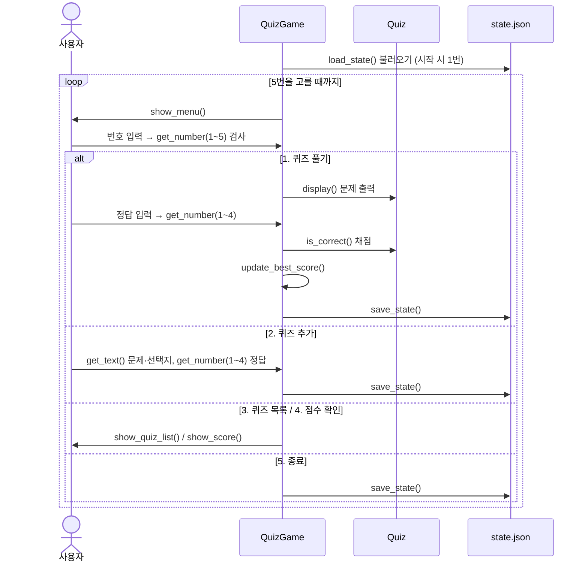

### 10.2 메뉴별 예외·경계 조건

| 메뉴 | 경계 조건 | 처리 |
|---|---|---|
| 공통 (메뉴 선택) | 빈 입력, `abc`, `0`, `9`, `  3  ` | 안내 후 재입력, 공백은 제거 후 처리 |
| 1. 퀴즈 풀기 | 퀴즈 0개 | `📭 등록된 퀴즈가 없습니다.` 후 메뉴로 |
| 1. 퀴즈 풀기 | 정답에 `5`, `0`, 글자 | 안내 후 같은 문제 재입력 |
| 2. 퀴즈 추가 | 문제·선택지가 빈칸 또는 공백만 | 안내 후 같은 항목 재입력 |
| 2. 퀴즈 추가 | 정답 번호가 1~4 밖 | 안내 후 재입력 |
| 3. 퀴즈 목록 | 퀴즈 0개 | `📭 등록된 퀴즈가 없습니다.` |
| 4. 점수 확인 | 아직 한 번도 풀지 않음 (`None`) | `📭 아직 퀴즈를 푼 기록이 없습니다.` |
| 어디서든 | `Ctrl+C`, `Ctrl+D` | 저장 후 안전 종료 |

---

## 11. 공통 입력 · 예외 처리

### 11.1 숫자 입력 검사 `get_number()`

메뉴(1~5), 정답(1~4), 퀴즈 추가의 정답 번호(1~4)에서 **같은 함수를 범위만 바꿔 재사용**합니다.

```python
def get_number(self, prompt, min_value, max_value):
    while True:
        text = input(prompt).strip()          # ① 앞뒤 공백 제거

        if text == "":                         # ② 빈 입력
            print("⚠️ 입력이 비어 있습니다. 숫자를 입력하세요.")
            continue

        try:
            number = int(text)                 # ③ 숫자 변환
        except ValueError:
            print(f"⚠️ 숫자만 입력하세요. ({min_value}-{max_value})")
            continue

        if number < min_value or number > max_value:   # ④ 범위 검사
            print(f"⚠️ {min_value}-{max_value} 사이의 숫자를 입력하세요.")
            continue

        return number
```

| 검사 | 걸리는 입력 | 처리 |
|---|---|---|
| 공백 제거 | `  3  ` | `.strip()` 후 `3`으로 정상 처리 |
| 빈 입력 | 그냥 Enter | 안내 후 `continue`로 재입력 |
| 숫자 변환 실패 | `abc`, `k`, `은`, `탄소` | `ValueError`를 잡아 안내 후 재입력 |
| 범위 밖 | 메뉴 `9`, `0` / 정답 `5`, `0` | 안내 후 재입력 |

### 11.2 실행 결과

```
선택: abc
⚠️ 숫자만 입력하세요. (1-5)
선택: 9
⚠️ 1-5 사이의 숫자를 입력하세요.
선택: 0
⚠️ 1-5 사이의 숫자를 입력하세요.
선택:
⚠️ 입력이 비어 있습니다. 숫자를 입력하세요.
```

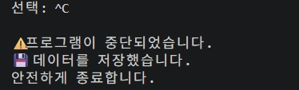

> 📸 **증빙:** 메뉴에서 `abc`, `9`, `0`, 빈 입력에 안내 후 재입력 (요구사항: 공통 입력/예외 처리)

### 11.3 Ctrl+C / EOF 안전 종료

`run()` 전체를 `try`로 감싸 `KeyboardInterrupt`(Ctrl+C)와 `EOFError`(Ctrl+D)를 잡고, **저장 후** 종료합니다.

```
선택: ^C

⚠️ 프로그램이 중단되었습니다.
💾 데이터를 저장했습니다.
안전하게 종료합니다.
```

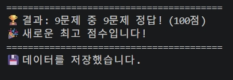

> 📸 **증빙:** `Ctrl+C`에 중단 → 저장 → 안전 종료, 빨간 오류 없음 (요구사항: KeyboardInterrupt 처리)

> 💡 3단계에서는 안내만 하고 종료했고, 7단계에서 저장 기능을 만든 뒤 **중단 시에도 저장**하도록 보완했습니다.

**종료 신호별 처리 범위 (우선순위 순)**

| 신호 | 언제 생기나 | 처리 |
|---|---|---|
| `KeyboardInterrupt` (SIGINT) | `Ctrl+C` | ✅ 잡아서 저장 후 종료 |
| `EOFError` | `Ctrl+D`, 입력 통로 끊김 | ✅ 잡아서 저장 후 종료 |
| SIGTERM / SIGHUP | 터미널 창 닫기, `kill` 명령 | ❌ 따로 처리하지 않음 → 대신 **데이터가 바뀔 때마다 즉시 저장**하므로 잃는 데이터가 거의 없음 |
| SIGKILL | `kill -9` | ❌ 운영체제가 강제 종료해 프로그램이 처리할 수 없음 |

### 11.4 입력 검증 ↔ 코드 매핑

| 검증 케이스 | 담당 메서드 | 사용 위치 |
|---|---|---|
| 공백 제거 `.strip()` | `get_number()`, `get_text()` | 모든 입력 |
| 빈 입력 | `get_number()`, `get_text()` | 메뉴, 정답, 퀴즈 추가 |
| 숫자 변환 실패 (`ValueError`) | `get_number()` | 메뉴, 정답, 정답 번호 |
| 범위 밖 숫자 | `get_number(prompt, 최소, 최대)` | 메뉴 1~5, 정답 1~4, 정답 번호 1~4 |
| 정답 판정 | `Quiz.is_correct()` | `play_quiz()`에서 `get_number(…, 1, 4)`로 검증된 값만 전달 |
| 저장 파일 내용 형식 | `check_quiz_data()` | `load_state()` |

---

## 12. Quiz 클래스와 기본 퀴즈 데이터

### 12.1 Quiz 클래스

```python
class Quiz:
    def __init__(self, question, choices, answer):
        self.question = question  # 문제 (str)
        self.choices = choices    # 선택지 4개 (list)
        self.answer = answer      # 정답 번호 1~4 (int)

    def display(self, number):
        print("-" * 40)
        print(f"[문제 {number}]")
        print(self.question)
        print()
        for i, choice in enumerate(self.choices, start=1):
            print(f"  {i}. {choice}")
        print()

    def is_correct(self, user_answer):
        return user_answer == self.answer

    def to_dict(self):
        return {"question": self.question, "choices": self.choices, "answer": self.answer}
```

| 메서드 | 역할 |
|---|---|
| `__init__` | 객체를 만들 때 문제·선택지·정답을 `self`에 저장 |
| `display(number)` | 문제 번호, 문제, 선택지 4개를 번호와 함께 출력 |
| `is_correct(user_answer)` | 고른 번호가 정답이면 `True`, 아니면 `False` |
| `to_dict()` | JSON에 저장할 수 있게 dict로 변환 (7단계에서 추가) |

`quiz.py`만 따로 실행해서 클래스를 먼저 검증했습니다.

```bash
$ python3 quiz.py
----------------------------------------
[문제 1]
원소 기호 'Fe'는 어떤 원소일까요?

  1. 금
  2. 은
  3. 철
  4. 구리

3번을 골랐을 때: True
1번을 골랐을 때: False
```

### 12.2 기본 원소 퀴즈 (Quiz 인스턴스 8개)

`get_default_quizzes()`가 `Quiz(...)` 객체 8개를 리스트로 돌려줍니다. 저장 파일이 없을 때 이 데이터로 시작합니다.

| # | 문제 | 정답 |
|---|---|---|
| 1 | 원소 기호 'Fe'는 어떤 원소일까요? | 3. 철 |
| 2 | 원자 번호 1번, 우주에서 가장 많고 가장 가벼운 원소는? | 1. 수소 |
| 3 | 원소 기호 'Au'는 어떤 원소일까요? | 2. 금 |
| 4 | 풍선에 넣으면 둥둥 떠오르는 가벼운 기체 원소는? | 3. 헬륨 |
| 5 | 실온에서 유일하게 액체 상태인 금속 원소는? | 2. 수은 |
| 6 | 다이아몬드와 연필심(흑연)을 이루는 원자 번호 6번 원소는? | 3. 탄소 |
| 7 | 원소 기호 'Na'는 어떤 원소일까요? | 4. 나트륨 |
| 8 | 우리가 숨 쉴 때 꼭 필요한 원자 번호 8번 원소는? | 2. 산소 |
| 9 | 원소 기호 'Ag'는 어떤 원소일까요? *(퀴즈 추가 기능으로 직접 등록)* | 2. 은 |

**기본 퀴즈 데이터 버전: v1** (8문제, 원소 기호 3·원자 번호 2·특징 3). 위치는 `quiz.py`의 `get_default_quizzes()`이며, 학습용 기초 원소 지식(초·중등 과학 수준)으로 직접 작성했습니다.
기본 문제를 바꾸려면 `get_default_quizzes()` 안의 `Quiz(...)`를 수정하고, 이미 만들어진 `state.json`을 지운 뒤 실행하면 새 기본 퀴즈로 시작합니다. (`state.json`이 있으면 그 내용이 우선)

> 💡 정답은 사람이 보는 번호(1~4)로 저장하고, 리스트에서 정답 글자를 꺼낼 때는 `choices[answer - 1]`을 사용합니다. Python 리스트는 **0번부터** 세기 때문입니다.

---

## 13. 퀴즈 풀기 (브랜치 생성 · 병합)

### 13.1 브랜치에서 개발

`main`을 건드리지 않고 새 기능을 만들기 위해 `feature/play-quiz` 브랜치에서 작업했습니다.

> **브랜치 규칙:** 새 기능은 `feature/<기능-이름>`(영어 소문자, 단어는 `-`로 연결) 브랜치에서 만들고, 실행 확인 후 `git merge --no-ff`로 `main`에 병합한다. `main`에는 항상 동작하는 코드만 둔다.

```bash
$ git checkout -b feature/play-quiz
Switched to a new branch 'feature/play-quiz'

$ git branch
* feature/play-quiz
  main

# (퀴즈 풀기 코드 작성 · 실행 확인)

$ git add main.py
$ git commit -m "Feat: 퀴즈 풀기 기능 구현 (출제, 채점, 결과 표시)"
$ git push -u origin feature/play-quiz
```

### 13.2 main으로 돌아와 병합

```bash
$ git checkout main
$ git merge --no-ff feature/play-quiz -m "Merge: 퀴즈 풀기 기능 브랜치 병합"
$ git push

$ git log --oneline --graph
*   4530f60 (HEAD -> main, origin/main) Merge: 퀴즈 풀기 기능 브랜치 병합
|\
| * 742c4b7 (origin/feature/play-quiz, feature/play-quiz) Feat: 퀴즈 풀기 기능 구현 (출제, 채점, 결과 표시)
|/
* c0e9deb Feat: 기본 원소 퀴즈 8개 추가
* 4f30599 Feat: Quiz 클래스 작성 (문제 출력, 정답 확인)
* e9d1ffc Feat: 숫자 입력 검증 및 Ctrl+C/EOF 예외 처리 추가
* 92d85b7 Feat: 메뉴 출력 및 선택 기능 구현
* 815229e Chore: 프로젝트 초기 설정 (README, .gitignore 추가)
```

| 확인한 것 | 근거 |
|---|---|
| 브랜치가 갈라졌다가 합쳐짐 | 그래프의 `\` (갈라짐) → `/` (합쳐짐) |
| 병합 전 `main`에는 기능이 없음 | 병합 전 시점(`c0e9deb`)에서 실행하면 1번이 `"퀴즈 풀기 기능은 준비 중입니다."` |
| 병합 후 `main`에 기능이 들어옴 | 병합 커밋 `4530f60` 이후 1번 메뉴에서 퀴즈 출제 |

> 💡 `--no-ff`를 붙여서 병합 기록(Merge 커밋)을 남겼습니다. 붙이지 않으면 기록이 한 줄로 합쳐져 그래프에서 브랜치 흔적이 보이지 않습니다.

병합 전 시점 확인 후 다시 `main`으로 복귀:

```bash
$ git checkout c0e9deb      # 병합 전 시점 구경 (detached HEAD)
$ git checkout main
Previous HEAD position was c0e9deb Feat: 기본 원소 퀴즈 8개 추가
Switched to branch 'main'
Your branch is up to date with 'origin/main'.
$ git branch
  feature/play-quiz
* main
```

### 13.3 퀴즈 풀기 동작

- 저장된 퀴즈를 순서대로 출제 → `get_number("정답 입력 (1-4): ", 1, 4)`로 답 입력
- 정답이면 `✅ 정답입니다!`, 오답이면 `❌ 아쉬워요! 정답은 2번 금입니다.`
- 모두 풀면 `점수 = int(맞힌 수 / 전체 수 × 100)` 출력 (예: 9문제 중 8문제 → 88점)
- 퀴즈가 0개면 `📭 등록된 퀴즈가 없습니다.` 안내 후 메뉴로 복귀

```
[문제 3]
원소 기호 'Au'는 어떤 원소일까요?

  1. 은
  2. 금
  3. 구리
  4. 알루미늄

정답 입력 (1-4): 5
⚠️ 1-4 사이의 숫자를 입력하세요.
정답 입력 (1-4): 4
❌ 아쉬워요! 정답은 2번 금입니다.
```

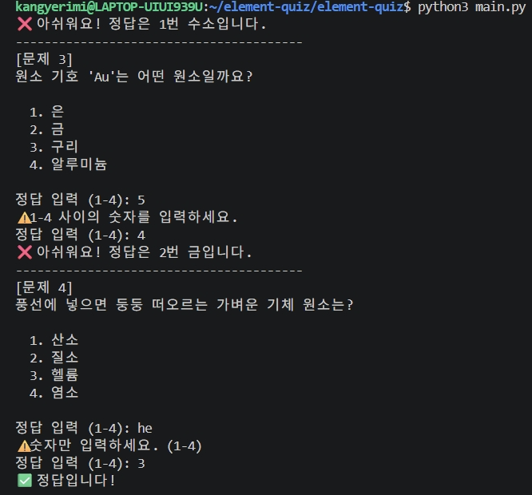

> 📸 **증빙:** 문제 출제, 오답 시 정답 안내, 정답 입력의 범위 밖(`5`)·글자(`he`) 재입력 (제출물: 플레이)

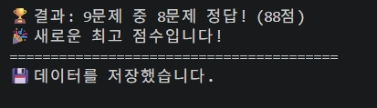

> 📸 **증빙:** 9문제 중 8문제 정답(88점) 결과 표시와 최고 점수 갱신·저장 (요구사항: 결과 표시, 최고 점수 갱신)

---

## 14. 파일 저장 / 불러오기 (state.json)

### 14.1 경로 · 역할 · 인코딩

| 항목 | 내용 |
|---|---|
| 경로 | 프로젝트 루트의 `state.json` (어느 폴더에서 실행해도 같은 위치 — [트러블슈팅 8](#트러블슈팅-8-다른-폴더에서-실행하면-statejson이-엉뚱한-곳에-생김)) |
| 역할 | 퀴즈 목록과 최고 점수를 저장해 **프로그램을 다시 실행해도 유지** |
| 인코딩 | UTF-8 (`encoding="utf-8"`), 한글을 그대로 저장하도록 `ensure_ascii=False` |
| 저장 시점 | 퀴즈 추가 직후 / 퀴즈를 다 푼 뒤 / 메뉴 5번 종료 / `Ctrl+C`·`EOF` 중단 |

### 14.2 스키마

| 키 | 자료형 | 설명 |
|---|---|---|
| `quizzes` | list | 퀴즈 목록 |
| `quizzes[].question` | str | 문제 |
| `quizzes[].choices` | list (str 4개) | 선택지 |
| `quizzes[].answer` | int (1~4) | 정답 번호 |
| `best_score` | int 또는 `null` | 최고 점수(0~100). 아직 풀지 않았으면 `null` |

```json
{
    "quizzes": [
        {
            "question": "원소 기호 'Fe'는 어떤 원소일까요?",
            "choices": ["금", "은", "철", "구리"],
            "answer": 3
        }
    ],
    "best_score": 88
}
```

### 14.3 저장 · 불러오기 흐름

```
[저장]      Quiz 객체 ──to_dict()──▶ dict ──json.dump()──▶ state.json
[불러오기]  state.json ──json.load()──▶ dict ──Quiz(...)──▶ Quiz 객체
```

```python
# 저장 위치: quiz_game.py가 있는 폴더(= 프로젝트 루트)
PROJECT_ROOT = os.path.dirname(os.path.abspath(__file__))
STATE_FILE = os.path.join(PROJECT_ROOT, "state.json")

# 저장: 임시 파일에 다 쓴 뒤 한 번에 교체 (쓰는 도중 멈춰도 원본이 깨지지 않음)
with open(TEMP_FILE, "w", encoding="utf-8") as file:
    json.dump(data, file, ensure_ascii=False, indent=4)
os.replace(TEMP_FILE, STATE_FILE)

# 불러오기
with open(STATE_FILE, "r", encoding="utf-8") as file:
    data = json.load(file)
```

### 14.4 파일이 없거나 손상된 경우

| 상황 | 잡는 예외 | 처리 |
|---|---|---|
| 파일 없음 (첫 실행) | `FileNotFoundError` | 기본 원소 퀴즈 8개로 시작 |
| JSON 문법이 깨짐 | `ValueError` | 안내 후 기본 퀴즈로 복구 |
| 필요한 키가 없음 | `KeyError` | 안내 후 기본 퀴즈로 복구 |
| 데이터 모양이 이상함 | `TypeError` | 안내 후 기본 퀴즈로 복구 |
| JSON 문법은 맞지만 내용이 규칙에 어긋남 (선택지 4개 아님, 정답이 1~4 밖이거나 글자, 최고 점수가 0~100 정수가 아님) | `check_quiz_data()`가 `ValueError` 발생 | 안내 후 기본 퀴즈로 복구 |
| 읽기/쓰기 권한 없음 | `PermissionError` | 파일 위치와 해결 방법(`ls -l`, `chmod 644`, 폴더 위치 확인) 안내 후 계속 진행 |
| 그 밖의 읽기/쓰기 오류 | `OSError` | 안내 후 계속 진행 |

**손상 파일 백업:** 복구하기 전에 `backup_broken_file()`이 손상된 원본을 `state.json.bak`으로 복사해 둡니다. 잘못 고친 파일이라도 원본 내용을 나중에 확인하거나 되살릴 수 있습니다.

```
⚠️ 저장 파일이 손상되어 기본 퀴즈로 복구합니다.
🗂️ 손상된 원본은 state.json.bak으로 백업했습니다.
```

**권한 오류 안내:**

```
⚠️ state.json을 읽을 권한이 없어 기본 퀴즈로 시작합니다.
   파일 위치: /home/kangyerimi/element-quiz/element-quiz/state.json
   ① 권한 확인:  ls -l state.json
   ② 권한 수정:  chmod 644 state.json
   ③ 프로젝트 폴더가 내 홈 폴더(~) 안에 있는지 확인하세요.
```

**저장 실패 시 정책:** 저장은 임시 파일(`state.json.tmp`)에 먼저 쓰고 성공하면 `os.replace()`로 원본과 한 번에 바꿉니다. 실패하면 기존 `state.json`은 그대로 남고, 화면에 안내한 뒤 게임을 계속하며 **다음 저장 시점(퀴즈 추가·풀이 완료·종료)에 자동으로 다시 시도**합니다.

> 💡 `FileNotFoundError`는 `OSError`의 한 종류라서, 더 구체적인 `FileNotFoundError`를 **먼저** 적어야 "파일 없음"을 구분할 수 있습니다.

### 14.5 검증

| 테스트 | 방법 | 결과 |
|---|---|---|
| A. 첫 실행 | `state.json`이 없는 상태로 실행 | `📂 저장된 데이터가 없어 기본 퀴즈로 시작합니다.` → 종료 시 파일 생성 |
| B. 재실행 | 다시 실행 | `📂 저장된 데이터를 불러왔습니다. (퀴즈 8개)` |
| C. 파일 손상 | `state.json` 첫 줄의 `{`를 지우고 실행 | `⚠️ 저장 파일이 손상되어 기본 퀴즈로 복구합니다.` → 종료 시 정상 파일로 다시 저장 |
| D. 중단 | 메뉴에서 `Ctrl+C` | 중단 → `💾 데이터를 저장했습니다.` → 안전하게 종료 |
| E. 형식 오류 | `"answer": 9`, 선택지 3개, `"best_score": "abc"`로 수정 후 실행 | `⚠️ 저장 파일이 손상되어 기본 퀴즈로 복구합니다.` (이전에는 퀴즈 풀기에서 `IndexError`로 종료됨) |
| F. 퀴즈 0개 | `{"quizzes": [], "best_score": null}`로 저장 후 1·3·4번 | `📭 등록된 퀴즈가 없습니다.` / `📭 아직 퀴즈를 푼 기록이 없습니다.` |
| G. 손상 백업 | `{`를 지운 뒤 실행 | 복구 안내 + `state.json.bak`에 손상 원본 보관 |
| H. 권한 오류 | `chmod 600` + 다른 사용자로 실행 | 읽기·쓰기 권한 안내 출력, 프로그램은 계속 동작 |

```
$ python3 main.py
💾 데이터를 저장했습니다.
👋 게임을 종료합니다. 다음에 또 만나요!
$ python3 main.py          ← state.json의 { 를 지운 뒤 실행
⚠️ 저장 파일이 손상되어 기본 퀴즈로 복구합니다.
```

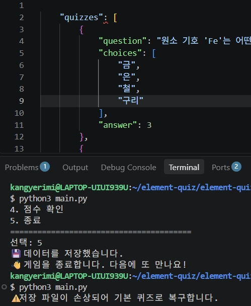

> 📸 **증빙:** `state.json`의 `{`를 지운 손상 파일로 실행해도 멈추지 않고 기본 퀴즈로 복구됨 (요구사항: 데이터 파일 손상 처리)

### 14.6 동시 실행 정책

이 게임은 **한 명이 한 번에 하나만 실행**하는 것을 전제로 합니다. 같은 폴더에서 두 개를 동시에 실행하면 **마지막에 저장한 쪽이 덮어씁니다**(임시 파일 교체 덕분에 파일이 깨지지는 않음). 여러 명이 함께 쓰게 된다면 저장 직전에 파일 잠금(Linux `fcntl.flock`)을 걸거나, 동시 쓰기를 지원하는 SQLite로 바꾸는 방향으로 확장합니다.

### 14.7 대용량(1000개 이상) 분석과 저장 형식 비교

퀴즈 수를 늘려 실제로 측정했습니다. (WSL Ubuntu, Python 3.14, 같은 형식의 퀴즈를 자동 생성)

| 퀴즈 수 | 파일 크기 | 불러오기 | 저장 | 메모리(최대) | 문제 검색(전체 훑기) |
|---|---|---|---|---|---|
| 1,000개 | 0.25MB | 11ms | 6ms | 1.0MB | 0.2ms |
| 10,000개 | 2.5MB | 95ms | 59ms | 10MB | 1.4ms |
| 100,000개 | 24.7MB | 1.2초 | 0.6초 | 104MB | 15ms |

- **1,000~10,000개:** 불러오기·저장 모두 0.1초 이내라 현재 구조로 충분합니다.
- **약 10만 개부터:** 시작할 때 1초 이상 걸리고, 매번 **전체 파일을 다시 쓰기** 때문에 저장이 느려집니다.
- **화면 문제:** 퀴즈 목록(3번)이 수천 줄 출력되고, 퀴즈 풀기(1번)도 전부 출제합니다.

**완화 방안**

| 문제 | 방안 |
|---|---|
| 목록이 너무 김 | 10개씩 끊어 보여주기(페이지), 검색어로 거르기 |
| 전부 출제됨 | `random.sample()`로 N문제만 뽑기 (보너스 과제와 연결) |
| 저장이 느려짐 | 바뀐 부분만 저장하는 형식(SQLite)으로 전환 |

**저장 형식 비교**

| 형식 | 장점 | 단점 | 적합한 규모 |
|---|---|---|---|
| **JSON (현재)** | 사람이 읽기 쉬움, 표준 라이브러리, dict와 같은 모양 | 매번 전체를 읽고 씀 | ~1만 개 |
| CSV | 엑셀로 열기 쉬움 | 선택지 4개 같은 목록 구조 표현이 불편 | 단순 표 |
| YAML | JSON보다 사람이 쓰기 쉬움 | 외부 라이브러리 필요(과제 제약 위반) | 설정 파일 |
| SQLite | 표준 라이브러리 `sqlite3`, 일부만 읽고 쓰기, 검색 빠름, 동시 접근 지원 | SQL을 배워야 함, 사람이 바로 읽기 어려움 | 10만 개 이상 |

---

## 15. 퀴즈 추가

문제 → 선택지 4개 → 정답 번호 순으로 입력받습니다.

- 문제·선택지: `get_text()`로 **빈 입력(공백만 친 경우 포함)** 차단
- 정답 번호: `get_number(..., 1, 4)`로 숫자·범위 검사
- 입력이 끝나면 `Quiz` 객체를 만들어 목록에 `append` → **바로 `state.json`에 저장**

```
📌 새로운 퀴즈를 추가합니다.

문제를 입력하세요:
⚠️ 내용이 비어 있습니다. 다시 입력하세요.
문제를 입력하세요: 원소 기호 'Ag'는 어떤 원소일까요?
선택지 1: 금
선택지 2:
⚠️ 내용이 비어 있습니다. 다시 입력하세요.
선택지 2: 은
선택지 3: 구리
선택지 4: 철
정답 번호 (1-4): 5
⚠️ 1-4 사이의 숫자를 입력하세요.
정답 번호 (1-4):
⚠️ 입력이 비어 있습니다. 숫자를 입력하세요.
정답 번호 (1-4): k
⚠️ 숫자만 입력하세요. (1-4)
정답 번호 (1-4): 은
⚠️ 숫자만 입력하세요. (1-4)
정답 번호 (1-4): 2

✅ 퀴즈가 추가되었습니다! (총 9개)
💾 데이터를 저장했습니다.
```

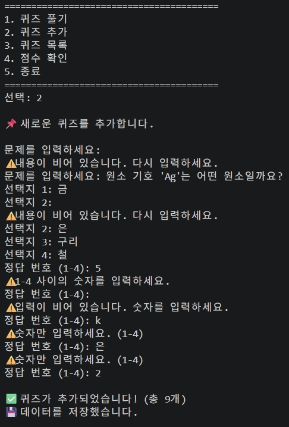

> 📸 **증빙:** 빈 문제·빈 선택지·`5`·빈칸·`k`·`은` 입력을 모두 막고 9번째 퀴즈를 추가·저장 (제출물: 퀴즈 추가)

**재시작 후 유지 확인:**

```
$ python3 main.py
📂 저장된 데이터를 불러왔습니다. (퀴즈 9개)
```

기본 8개에서 **9개로 유지**되는 것으로 데이터 영속성을 확인했습니다.

---

## 16. 퀴즈 목록

등록된 퀴즈의 **문제만** 번호와 함께 보여줍니다. 선택지와 정답은 풀기 전에 답을 알 수 없도록 표시하지 않습니다. 퀴즈가 0개면 안내 메시지를 출력합니다.

```
📋 등록된 퀴즈 목록 (총 9개)

----------------------------------------
[1] 원소 기호 'Fe'는 어떤 원소일까요?
[2] 원자 번호 1번, 우주에서 가장 많고 가장 가벼운 원소는?
[3] 원소 기호 'Au'는 어떤 원소일까요?
[4] 풍선에 넣으면 둥둥 떠오르는 가벼운 기체 원소는?
[5] 실온에서 유일하게 액체 상태인 금속 원소는?
[6] 다이아몬드와 연필심(흑연)을 이루는 원자 번호 6번 원소는?
[7] 원소 기호 'Na'는 어떤 원소일까요?
[8] 우리가 숨 쉴 때 꼭 필요한 원자 번호 8번 원소는?
[9] 원소 기호 'Ag'는 어떤 원소일까요?
----------------------------------------
```

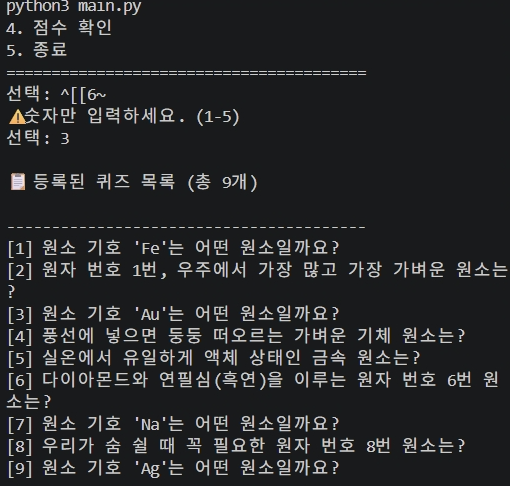

> 📸 **증빙:** 직접 추가한 9번 'Ag' 문제를 포함한 목록, 정답은 숨김 (제출물: 목록)

---

## 17. 점수 확인 (최고 점수)

퀴즈를 다 풀 때마다 `update_best_score()`가 최고 점수와 비교하고, 갱신되면 바로 저장합니다.

```python
def update_best_score(self, score):
    if self.best_score is None or score > self.best_score:
        print("🎉 새로운 최고 점수입니다!")
        self.best_score = score
    else:
        print(f"💪 최고 점수는 {self.best_score}점이에요. 다음엔 꼭 넘어봐요!")
```

| 상황 | 기존 최고 점수 | 이번 점수 | 결과 |
|---|---|---|---|
| 첫 도전 | `None` | 66 | 🎉 66으로 갱신 |
| 더 잘함 | 66 | 88 | 🎉 88로 갱신 |
| 더 못함 | 88 | 44 | 💪 88 유지 |
| 같음 | 88 | 88 | 💪 88 유지 |

- 아직 한 번도 풀지 않았으면(`None`) 메뉴 4번에서 `📭 아직 퀴즈를 푼 기록이 없습니다.` 안내
- `None`(안 풀어 봄)과 `0`(풀었는데 다 틀림)을 구분하기 위해 `is None`으로 비교

```
선택: 4

🏆 최고 점수: 88점
```

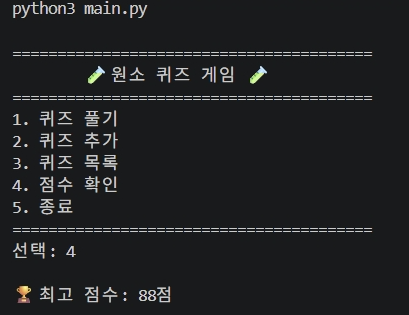

> 📸 **증빙:** 메뉴 4번에서 최고 점수 88점 표시 (제출물: 점수)

**재시작 후 유지 확인:**

```
📂 저장된 데이터를 불러왔습니다. (퀴즈 9개, 최고 점수 88점)
```

---

## 18. QuizGame 클래스로 구조 정리 (리팩터링)

### 18.1 왜 정리했나

10단계까지는 `main.py`에 함수가 흩어져 있었고, 퀴즈 목록과 최고 점수를 **함수마다 매개변수로 넘겨야** 했습니다.
`QuizGame` 클래스가 이 데이터를 **속성으로 직접 가지도록** 바꾸어 넘겨줄 필요를 없앴습니다. 게임 동작은 바꾸지 않았습니다.

### 18.2 Before / After

```python
# Before: 함수마다 데이터를 넘겨줌
quizzes, best_score = load_state()
play_quiz(quizzes)
save_state(quizzes, best_score)

# After: QuizGame이 데이터를 직접 가짐
game = QuizGame()   # __init__에서 state.json 불러오기
game.run()
```

| Before | After |
|---|---|
| `quizzes` (따로 다니는 변수) | `self.quizzes` (QuizGame의 속성) |
| `best_score` | `self.best_score` |
| `play_quiz(quizzes)` | `self.play_quiz()` |
| `main.py` 233줄 | `main.py` 10줄 (시작점만) + `quiz_game.py` |

```python
# main.py
from quiz_game import QuizGame


def main():
    game = QuizGame()
    game.run()


if __name__ == "__main__":
    main()
```

### 18.3 확장할 때 바꿀 지점

저장 방식을 JSON에서 SQLite 같은 DB로 바꾸려면 **`load_state()`와 `save_state()`만** 교체하면 됩니다. 나머지 메서드는 `self.quizzes`(Quiz 목록)와 `self.best_score`만 쓰기 때문입니다. 더 나아가 저장 담당을 `Storage` 클래스로 따로 빼면, `QuizGame`은 `Storage`를 바꿔 끼우기만 하면 됩니다.

### 18.4 검증

리팩터링 후 메뉴 1~5번, 잘못된 입력, `Ctrl+C`를 다시 실행해 **이전과 똑같이 동작**하는 것을 확인했습니다.

```bash
$ git status
Changes not staged for commit:
        modified:   main.py
Untracked files:
        quiz_game.py

$ git add .
$ git commit -m "Refactor: QuizGame 클래스로 게임 로직 분리"
[main 6029d62] Refactor: QuizGame 클래스로 게임 로직 분리
 2 files changed, 241 insertions(+), 228 deletions(-)
 create mode 100644 quiz_game.py
```

---

## 19. clone · pull 실습

**시나리오:** 원래 폴더 = 나, 복제 폴더 = 가상의 팀원

```
원래 폴더 (나)                 GitHub                 복제 폴더 (팀원)
~/element-quiz/element-quiz      │                    ~/element-quiz-clone
                                 ├──── ① clone ────▶  통째로 복사
                                 │                    ② README 한 줄 추가
                                 │◀──── ③ push ─────
       ◀──── ④ pull ─────────────┤
```

### 19.1 clone (복제 폴더)

```bash
kangyerimi@LAPTOP-UIUI939U:~$ git clone https://github.com/kangyerimi/element-quiz.git element-quiz-clone
kangyerimi@LAPTOP-UIUI939U:~$ cd element-quiz-clone
kangyerimi@LAPTOP-UIUI939U:~/element-quiz-clone$ ls
README.md  main.py  quiz.py  quiz_game.py
```

> `state.json`은 `.gitignore`로 제외했기 때문에 복제본에는 없는 것이 정상입니다.

### 19.2 복제본에서 수정 → commit → push

```bash
kangyerimi@LAPTOP-UIUI939U:~/element-quiz-clone$ echo "" >> README.md
kangyerimi@LAPTOP-UIUI939U:~/element-quiz-clone$ echo "> 🔄 이 문장은 clone한 저장소에서 추가하고, 원래 저장소에서 pull로 가져온 문장입니다." >> README.md
kangyerimi@LAPTOP-UIUI939U:~/element-quiz-clone$ git add README.md
kangyerimi@LAPTOP-UIUI939U:~/element-quiz-clone$ git commit -m "Docs: README에 clone/pull 실습 문장 추가"
kangyerimi@LAPTOP-UIUI939U:~/element-quiz-clone$ git push
To https://github.com/kangyerimi/element-quiz.git
   6971b3e..106c97c  main -> main
```

### 19.3 원래 폴더에서 pull → 반영 확인

```bash
kangyerimi@LAPTOP-UIUI939U:~$ cd ~/element-quiz/element-quiz
kangyerimi@LAPTOP-UIUI939U:~/element-quiz/element-quiz$ git pull
kangyerimi@LAPTOP-UIUI939U:~/element-quiz/element-quiz$ git log --oneline -1
106c97c (HEAD -> main, origin/main, origin/HEAD) Docs: README에 clone/pull 실습 문장 추가

# 한 번 더 pull → 이미 최신 상태, README 끝에 문장 반영 확인
kangyerimi@LAPTOP-UIUI939U:~/element-quiz/element-quiz$ git pull
Already up to date.
kangyerimi@LAPTOP-UIUI939U:~/element-quiz/element-quiz$ tail -n 3 README.md
> 처음 실행하면 자동으로 생성됩니다.

> 🔄 이 문장은 clone한 저장소에서 추가하고, 원래 저장소에서 pull로 가져온 문장입니다.
```

**결론:** 복제본(팀원)에서 push한 커밋 `106c97c`가 원래 폴더의 `git log` 맨 위에 나타나고, README 마지막 줄에 문장이 들어와 pull이 정상 반영된 것을 확인했습니다.

| 명령 | 언제 쓰나 |
|---|---|
| `git clone` | 저장소가 내 컴퓨터에 **아예 없을 때** 처음 한 번 통째로 받기 |
| `git pull` | 이미 있는 저장소에 **새 변경만** 가져오기 |

> 실습용 문장은 확인 후 문서 정리 과정에서 이 섹션으로 옮겼습니다.

---

## 20. Git 작업 기록

### 20.1 커밋 목록 (해시 · 메시지)

`git log --oneline --graph` 결과입니다. 맨 위 2개는 평가 피드백을 반영한 커밋이며, 최종 그래프는 제출용 스크린샷으로 확인할 수 있습니다.

| # | 해시 | 커밋 메시지 | 종류 |
|---|---|---|---|
| 20 | (이 커밋) | Docs: 평가 피드백 반영하여 README 보완 | 문서 |
| 19 | `f860a90` | Fix: 권한 오류 안내, 손상 파일 백업, 안전 저장 추가 | **기능** |
| 18 | `84a1924` | Docs: README를 개발 과정 중심 기술 문서로 재작성 (개발 환경 사진) | 문서 |
| 17 | `529723d` | Docs: README를 개발 과정 중심 기술 문서로 재작성 | 문서 |
| 16 | `88e14b8` | Fix: state.json 경로를 프로젝트 루트로 고정하고 저장 데이터 형식 검사 추가 | **기능** |
| 15 | `7f3e728` | Docs: README에 실행 화면 및 예외 처리 스크린샷 추가 | 문서 |
| 14 | `106c97c` | Docs: README에 clone/pull 실습 문장 추가 | 문서 |
| 13 | `6971b3e` | Docs: README 작성 (개요, 주제, 실행 방법, 기능, 파일 구조, 데이터 설명) | 문서 |
| 12 | `6029d62` | Refactor: QuizGame 클래스로 게임 로직 분리 | **기능** |
| 11 | `a9388b1` | Feat: 최고 점수 확인 및 갱신 기능 구현 | **기능** |
| 10 | `6fa3f01` | Feat: 퀴즈 목록 보기 기능 구현 | **기능** |
| 9 | `7c6f031` | Feat: 퀴즈 추가 기능 구현 (입력 검증 및 파일 저장) | **기능** |
| 8 | `804a17c` | Feat: state.json 저장/불러오기 및 파일 손상 처리 구현 | **기능** |
| 7 | `4530f60` | Merge: 퀴즈 풀기 기능 브랜치 병합 | **기능** |
| 6 | `742c4b7` | Feat: 퀴즈 풀기 기능 구현 (출제, 채점, 결과 표시) — `feature/play-quiz` | **기능** |
| 5 | `c0e9deb` | Feat: 기본 원소 퀴즈 8개 추가 | **기능** |
| 4 | `4f30599` | Feat: Quiz 클래스 작성 (문제 출력, 정답 확인) | **기능** |
| 3 | `e9d1ffc` | Feat: 숫자 입력 검증 및 Ctrl+C/EOF 예외 처리 추가 | **기능** |
| 2 | `92d85b7` | Feat: 메뉴 출력 및 선택 기능 구현 | **기능** |
| 1 | `815229e` | Chore: 프로젝트 초기 설정 (README, .gitignore 추가) | 준비 |

**기능 커밋(굵게 표시) 13개 + 문서·준비 커밋 7개 = 총 20개.**

```
*   4530f60 Merge: 퀴즈 풀기 기능 브랜치 병합
|\
| * 742c4b7 (origin/feature/play-quiz, feature/play-quiz) Feat: 퀴즈 풀기 기능 구현 (출제, 채점, 결과 표시)
|/
* c0e9deb Feat: 기본 원소 퀴즈 8개 추가
```

> 17·18번은 README 수정과 사진 추가를 같은 메시지로 두 번 커밋한 것입니다. 사진 추가는 `Docs: 개발 환경 스크린샷 추가`처럼 따로 적었어야 했습니다.

### 20.2 커밋 메시지 규칙

| 머리말 | 의미 | 사용 예 |
|---|---|---|
| `Feat` | 새 기능 | 메뉴, 입력 검증, Quiz 클래스, 퀴즈 풀기·추가·목록·점수, 저장 |
| `Refactor` | 동작은 그대로, 구조 정리 | QuizGame 클래스 분리 |
| `Docs` | 문서 | README 작성, clone/pull 실습, 스크린샷, README 재작성 |
| `Chore` | 기능 외 준비 작업 | 초기 설정 |
| `Merge` | 브랜치 병합 | feature/play-quiz 병합 |
| `Fix` | 오류 수정 | state.json 경로 고정, 저장 데이터 형식 검사, 권한 오류 안내·백업 |

> **커밋 단위 규칙:** 커밋 1개 = 기능 1개 또는 버그 수정 1개. 실행해서 확인한 뒤 커밋하고, 서로 다른 일(기능 + 문서)은 따로 커밋한다.

### 20.3 Git 7종 명령어 사용 위치

| 명령 | 하는 일 | 사용한 곳 |
|---|---|---|
| `init` | 폴더를 Git 저장소로 만들기 | [9장](#9-git-저장소-설정과-첫-커밋) |
| `add` | 커밋할 변경 담기 | 모든 기능 커밋 |
| `commit` | 저장 지점 기록 | 모든 기능 커밋 |
| `push` | GitHub에 올리기 | 모든 기능 커밋 |
| `checkout` | 브랜치 생성·이동, 과거 시점 확인 | [13장](#13-퀴즈-풀기-브랜치-생성--병합) |
| `clone` | 저장소 복제 | [19장](#19-clone--pull-실습) |
| `pull` | 원격 변경 가져오기 | [19장](#19-clone--pull-실습) |

---

## 21. 트러블슈팅

### 트러블슈팅 1: push 시 인증 도우미를 찾지 못함

| 단계 | 내용 |
|---|---|
| **문제** | 첫 `git push`에서 `git-credential-manager.exe: not found` 메시지 출력 |
| **원인 가설** | 우분투 Git이 윈도우 Git의 로그인 도우미를 빌려 쓰도록 설정했는데, 그 경로가 실제와 다르다 |
| **확인** | `ls "/mnt/c/Program Files/Git/mingw64/bin/"` → `No such file or directory`. 윈도우 Git이 예상한 위치에 없음 |
| **해결** | 잘못된 설정 삭제(`git config --global --unset credential.helper`) → GitHub CLI 설치(`sudo apt install gh`) → `gh auth login`으로 우분투 안에서 직접 로그인 |
| **배운 점** | WSL 우분투와 윈도우는 별개의 환경이다. 리눅스 쪽 인증은 리눅스 도구(`gh`)로 하는 것이 단순하고 안정적이다 |

```bash
$ git push -u origin main
/mnt/c/Program\ Files/Git/mingw64/bin/git-credential-manager.exe get: 1: ... not found
```

### 트러블슈팅 2: gh 로그인 시 브라우저가 자동으로 열리지 않음

| 단계 | 내용 |
|---|---|
| **문제** | `gh auth login`에서 Enter를 눌러도 `Failed opening a web browser` 출력 |
| **원인** | 우분투(WSL)에는 윈도우 브라우저를 여는 프로그램(`xdg-open`, `wslview` 등)이 없음 |
| **해결** | 윈도우 브라우저에서 `github.com/login/device`를 직접 열고 일회용 코드 입력 → `✓ Logged in as kangyerimi` |
| **배운 점** | 터미널 로그인은 "기기 코드" 방식으로 다른 화면에서 인증할 수 있다 |

### 트러블슈팅 3: 폴더가 두 겹으로 생성됨

| 단계 | 내용 |
|---|---|
| **문제** | 프롬프트 위치가 `~/element-quiz/element-quiz$`로 표시됨 |
| **원인** | `mkdir element-quiz`를 폴더 안에서 한 번 더 실행해 같은 이름의 폴더가 중첩됨 |
| **해결** | Git 저장소와 파일이 안쪽 폴더에 있으므로, 안쪽 폴더를 `code -r .`로 VSCode에서 다시 열어 그곳을 작업 폴더로 고정 |
| **배운 점** | 명령 전에 프롬프트의 현재 위치(`:` 뒤)와 `pwd`를 확인하는 습관이 필요하다 |

### 트러블슈팅 4: 게임 실행 중에 Git 명령을 입력함

| 단계 | 내용 |
|---|---|
| **문제** | `git add`, `git commit`을 쳤는데 `⚠️ 숫자만 입력하세요. (1-5)`만 출력되고 커밋되지 않음 |
| **원인** | 게임이 켜진 상태(`선택:`)라 입력이 터미널이 아니라 **게임의 `input()`** 으로 들어감 |
| **해결** | `5`로 게임 종료 → `$` 프롬프트 확인 후 Git 명령 재실행 |
| **배운 점** | `선택:`은 프로그램 입력, `$`는 셸 입력. 덕분에 입력 검사가 어떤 문자열에도 안전하게 동작함을 확인했다 |

```
선택: git add main.py
⚠️ 숫자만 입력하세요. (1-5)
선택: git push
⚠️ 숫자만 입력하세요. (1-5)
선택: 5
💾 데이터를 저장했습니다.
👋 게임을 종료합니다. 다음에 또 만나요!
```

### 트러블슈팅 5: README 편집 중 내용이 모두 사라짐

| 단계 | 내용 |
|---|---|
| **문제** | README에 명령어를 잘못 붙여넣은 뒤 `Ctrl+Z`를 여러 번 눌러 README 내용이 전부 지워짐 |
| **원인** | 되돌리기가 붙여넣기 이전의 편집까지 모두 취소함 |
| **해결** | `git restore README.md`로 마지막 커밋 상태 복구 → VSCode 탭을 **저장하지 않고** 닫았다가 다시 열기 |
| **배운 점** | 커밋해 둔 파일은 언제든 되돌릴 수 있다. Git이 "세이브 포인트"인 이유를 직접 경험했다 |

### 트러블슈팅 6: README 내용이 두 번 반복됨

| 단계 | 내용 |
|---|---|
| **문제** | GitHub에서 README의 1~6번 항목이 두 번 나오고, 실행 화면이 맨 아래에 따로 붙어 있음 |
| **원인** | README 작성 시 기존 내용을 지우지 않고 그 아래에 다시 붙여넣음 (`6971b3e`부터 중복) |
| **확인** | `grep -n '^## ' README.md` → `## 1. 프로젝트 개요`가 두 번 검색됨 |
| **해결** | README를 개발 과정 중심 기술 문서로 다시 작성하고 `Docs` 커밋으로 반영 |
| **배운 점** | push 후에는 GitHub 화면에서 결과물을 직접 확인해야 한다 |

### 트러블슈팅 7: 저장 파일 내용이 이상하면 퀴즈 풀기에서 프로그램이 멈춤

| 단계 | 내용 |
|---|---|
| **문제** | `state.json`의 정답을 `9`로 바꾸거나 선택지를 3개로 줄이면, 불러오기는 되지만 퀴즈 풀기에서 오답을 고를 때 `IndexError`로 프로그램이 멈춤. 정답을 `"2"`(글자)로 바꾸면 `TypeError` 발생 |
| **원인** | 기존 검사는 JSON 문법 오류와 키 누락만 잡았고, **값이 규칙(선택지 4개, 정답 1~4 정수)에 맞는지**는 확인하지 않았음 |
| **해결** | `check_quiz_data()` 메서드를 추가해 불러올 때 문제·선택지·정답·최고 점수 형식을 검사하고, 어긋나면 `ValueError`를 일으켜 기존 "손상 파일 → 기본 퀴즈로 복구" 흐름을 타게 함 |
| **배운 점** | "파일이 손상됨"에는 문법이 깨진 경우뿐 아니라 **내용이 규칙에 어긋난 경우**도 포함된다 |

```python
def check_quiz_data(self, item):
    if type(item["question"]) is not str or item["question"].strip() == "":
        raise ValueError("문제 형식이 올바르지 않음")
    choices = item["choices"]
    if type(choices) is not list or len(choices) != 4:
        raise ValueError("선택지는 4개여야 함")
    for choice in choices:
        if type(choice) is not str:
            raise ValueError("선택지 형식이 올바르지 않음")
    answer = item["answer"]
    if type(answer) is not int or not 1 <= answer <= 4:
        raise ValueError("정답은 1~4 사이의 숫자여야 함")
```

### 트러블슈팅 8: 다른 폴더에서 실행하면 state.json이 엉뚱한 곳에 생김

| 단계 | 내용 |
|---|---|
| **문제** | 프로젝트 폴더 밖에서 `python3 element-quiz/main.py`처럼 실행하면 `state.json`이 **실행한 위치**에 생기고, 프로젝트 루트의 저장 데이터를 불러오지 못함 |
| **원인** | `STATE_FILE = "state.json"`은 상대 경로라서, 파이썬이 **현재 작업 폴더** 기준으로 파일을 찾음 |
| **해결** | `os.path.dirname(os.path.abspath(__file__))`로 `quiz_game.py`가 있는 폴더(= 프로젝트 루트)를 구해 그 안의 `state.json`을 사용 (`os`는 표준 라이브러리) |
| **배운 점** | 상대 경로는 "어디서 실행했는지"에 따라 가리키는 곳이 달라진다. 과제 요구사항의 "프로젝트 루트"를 지키려면 기준 위치를 코드로 정해야 한다 |

---

## 22. 검증 방법 요약

| 항목 | 검증 방법 | 확인한 것 | 증거 위치 |
|---|---|---|---|
| 개발 환경 | `python3 --version`, `git --version`, `git config --global --list` | Python 3.14.4, Git 2.53.0, 사용자 설정 | [8장](#8-개발-환경-구축-wsl--git) |
| 메뉴 | 1~5 입력 | 기능 분기, 5번 종료 | [10장](#10-메뉴-기능) |
| 입력 검사 | `abc`, `9`, `0`, 빈 입력, `  3  ` | 안내 후 재입력, 공백 제거 | [11장](#11-공통-입력--예외-처리) |
| 안전 종료 | `Ctrl+C`, `Ctrl+D` | 저장 후 종료, 오류 없음 | [11.3](#113-ctrlc--eof-안전-종료) |
| Quiz 클래스 | `python3 quiz.py` | 출력, `True`/`False` 채점 | [12장](#12-quiz-클래스와-기본-퀴즈-데이터) |
| 퀴즈 풀기 | 1번 메뉴, 오답·범위 밖 입력 | 정답/오답 안내, 점수 계산 | [13장](#13-퀴즈-풀기-브랜치-생성--병합) |
| 브랜치 | `git log --oneline --graph` | 갈라짐·병합 그래프 | [13.2](#132-main으로-돌아와-병합) |
| 저장/불러오기 | 파일 없음·재실행·`{` 삭제·`Ctrl+C` | 기본 퀴즈 시작, 불러오기, 손상 복구, 중단 시 저장 | [14.5](#145-검증) |
| 퀴즈 추가 | 빈 문제·빈 선택지·`5`·`k` 입력 후 재실행 | 재입력, 퀴즈 9개 유지 | [15장](#15-퀴즈-추가) |
| 퀴즈 목록 | 3번 메뉴 | 문제 9개 표시, 정답 숨김 | [16장](#16-퀴즈-목록) |
| 최고 점수 | 높은 점수·낮은 점수로 두 번 풀기 후 재실행 | 갱신/유지, 재실행 후 유지 | [17장](#17-점수-확인-최고-점수) |
| 리팩터링 | 전체 기능 재실행 | 동작 동일 | [18장](#18-quizgame-클래스로-구조-정리-리팩터링) |
| clone · pull | 복제본 push 후 원래 폴더 pull, `tail -n 3` | 변경 반영 | [19장](#19-clone--pull-실습) |
| 형식 오류·저장 경로 | 정답 `9`·선택지 3개 파일, 다른 폴더에서 실행 | 기본 퀴즈로 복구, 항상 프로젝트 루트에 저장 | [트러블슈팅 7·8](#트러블슈팅-7-저장-파일-내용이-이상하면-퀴즈-풀기에서-프로그램이-멈춤) |
| 백업·권한 오류 | 손상 파일 실행, `chmod 600` 후 다른 사용자로 실행 | `.bak` 백업 생성, 권한 안내 후 계속 동작 | [14.4](#144-파일이-없거나-손상된-경우) |
| 대용량 | 1,000·10,000·100,000개 자동 생성 후 측정 | 1만 개까지 0.1초 이내 | [14.7](#147-대용량1000개-이상-분석과-저장-형식-비교) |

---

## 23. 개념 정리

### 23.1 변수와 자료형

**변수**는 값에 이름을 붙여 담아 두는 상자입니다. 같은 값을 여러 곳에서 다시 쓰고, 값이 바뀌어도 이름으로 찾을 수 있습니다.

| 자료형 | 의미 | 이 프로젝트에서 |
|---|---|---|
| `int` | 정수 | 정답 번호 `3`, 점수 `88` |
| `str` | 문자열 | 문제, 선택지 |
| `bool` | 참/거짓 | `is_correct()` 결과 |
| `list` | 순서 있는 목록 (번호로 꺼냄, 0부터) | 선택지 4개, 퀴즈 목록 |
| `dict` | 이름표(키)로 꺼내는 묶음 | `state.json`에 저장하는 데이터 |
| `None` | 값이 아직 없음 (JSON의 `null`) | 한 번도 풀지 않은 최고 점수 |

### 23.2 조건문과 반복문

- `if / elif / else`: 메뉴 번호, 정답 여부, 최고 점수 갱신 여부에 따라 다른 동작
- `for`: **정해진 개수만큼** 반복 → 선택지 4개 출력, 퀴즈 9문제 출제, 선택지 4개 입력(`range(1, 5)`)
- `while`: **조건이 맞는 동안 계속** 반복 → 메뉴 반복, 올바른 입력이 들어올 때까지 재입력
- `break`는 반복 종료, `continue`는 반복의 처음으로 돌아가기

### 23.3 함수 · 매개변수 · 반환값

함수는 여러 명령을 하나로 묶고 이름을 붙인 것입니다. `get_number(prompt, min_value, max_value)`는 **매개변수**로 범위를 받아 메뉴(1~5)와 정답(1~4)에서 재사용하고, 검사를 통과한 숫자를 **반환값**(`return`)으로 돌려줍니다.

### 23.4 클래스와 객체, `__init__`과 `self`

- **클래스**는 설계도(붕어빵 틀), **객체**는 그 설계도로 만든 실체(붕어빵)입니다. `Quiz` 틀로 퀴즈 객체 9개를 만들었습니다.
- 클래스를 쓰면 데이터(속성)와 그 데이터를 다루는 기능(메서드)을 한 덩어리로 관리할 수 있습니다.
- `__init__`은 객체를 만들 때 자동으로 실행되어 속성을 준비하는 메서드입니다.
- `self`는 "지금 이 객체 자신"입니다. 퀴즈가 여러 개여도 `self.answer`는 각자의 정답을 가리킵니다.

### 23.5 파일 입출력과 JSON

- `open(파일, "r"/"w", encoding="utf-8")`로 파일을 열고, `with`를 쓰면 작업 후 자동으로 닫힙니다.
- **JSON**은 사람도 읽고 컴퓨터도 읽는 텍스트 데이터 형식입니다. Python의 dict·list와 구조가 같아 변환이 쉽고, 표준 라이브러리 `json`만으로 다룰 수 있어 저장 형식으로 선택했습니다.
- `try / except`는 "일단 실행하고, 오류가 나면 이렇게 처리"하는 안전망입니다.

### 23.6 Git vs GitHub, 브랜치

| 구분 | Git | GitHub |
|---|---|---|
| 정체 | 내 컴퓨터의 버전 관리 프로그램 | Git 저장소를 올려두는 온라인 서비스 |
| 역할 | 변경 기록(commit), 브랜치, 되돌리기 | 원격 백업, 공유, 협업 |
| 비유 | 게임의 세이브 기능 | 세이브 파일을 올리는 클라우드 |

**브랜치**는 `main`을 건드리지 않고 새 기능을 실험하는 평행한 작업 줄기입니다. 완성되면 `merge`로 합칩니다.

---

## 24. 유지보수 가이드 (요구 변경 시 수정 위치)

요구사항이 바뀌면 아래 표에서 고칠 곳을 찾습니다.

| 요구 변경 | 수정할 파일 · 메서드 | 함께 확인할 것 |
|---|---|---|
| 점수 계산 방식 (예: 감점, 맞힌 개수로 표시) | `quiz_game.py` → `play_quiz()`의 `score = ...`, `update_best_score()` | `show_score()` 출력 문구, `check_quiz_data()`의 `best_score` 범위(0~100) |
| 선택지 개수 (예: 4개 → 5개) | `quiz.py` → `Quiz`, `get_default_quizzes()` / `quiz_game.py` → `add_quiz()`의 `range(1, 5)`, `play_quiz()`의 `get_number(…, 1, 4)` | `check_quiz_data()`의 `len(choices) != 4`, 기존 `state.json` |
| 퀴즈에 항목 추가 (예: 힌트) | `quiz.py` → `Quiz.__init__()`, `to_dict()`, `display()` | `load_state()`의 `Quiz(...)` 생성, `check_quiz_data()`, `add_quiz()` |
| 저장 방식 (예: SQLite) | `quiz_game.py` → `load_state()`, `save_state()` | `STATE_FILE`, `.gitignore`, README 14장 |
| 기본 퀴즈 내용 | `quiz.py` → `get_default_quizzes()` | 기존 `state.json` 삭제 후 실행 |
| 메뉴 추가 (예: 6. 퀴즈 삭제) | `quiz_game.py` → `show_menu()`, `run()`의 `get_number("선택: ", 1, 5)`와 `elif`, 새 메서드 | 삭제 후 `save_state()` 호출 |
| 입력 안내 문구 | `quiz_game.py` → `get_number()`, `get_text()` | 없음 |

---

## 25. 배운 점과 향후 개선

### 배운 점

1. **작게 만들고 바로 확인하기**: 메뉴 → 입력 검사 → 클래스 → 기능 순서로 쌓으면서, 단계마다 실행·커밋하니 문제가 생겨도 원인을 빨리 찾을 수 있었다.
2. **함수와 클래스의 이점**: 입력 검사 함수 하나를 범위만 바꿔 세 곳에서 썼고, `QuizGame`으로 묶은 뒤 데이터를 넘겨주는 코드가 사라졌다.
3. **예외 처리의 필요성**: 실제로 게임 안에 Git 명령을 잘못 입력했을 때도 프로그램이 멈추지 않았다. 사용자는 예상하지 못한 입력을 한다.
4. **Git은 안전망**: README를 통째로 지웠을 때 `git restore` 한 줄로 복구했다.

### 향후 개선 (보너스 과제 미구현 항목)

| 기능 | 구현 아이디어 |
|---|---|
| 랜덤 출제 | `random.shuffle()`로 문제 순서 섞기 |
| 문제 수 선택 | `get_number()`로 1~전체 개수 입력받아 앞에서부터 출제 |
| 힌트 | `Quiz`에 `hint` 속성 추가, 힌트 사용 시 감점 |
| 퀴즈 삭제 | 목록 번호를 입력받아 `del self.quizzes[i]` 후 저장 |
| 점수 히스토리 | `state.json`에 `history` 리스트(날짜, 문제 수, 점수) 추가 |

---

---

## 26. 평가 피드백 반영 내역

1차 평가(83점)에서 받은 피드백을 다음과 같이 반영했습니다.

| # | 피드백 | 반영 | 위치 |
|---|---|---|---|
| 1 | 메뉴별 흐름·경계 조건 | 시퀀스 다이어그램, 메뉴별 경계 조건 표 | [10.1](#101-메뉴별-동작-흐름), [10.2](#102-메뉴별-예외경계-조건) |
| 2 | 입력 검증 ↔ 코드 매핑 | 검증 케이스별 메서드·사용 위치 표 | [11.4](#114-입력-검증--코드-매핑) |
| 3 | 동시 실행 정책 | 단일 실행 전제, 확장 방향 | [14.6](#146-동시-실행-정책) |
| 4 | 기본 데이터 출처·버전 | v1 표기, 수정 방법 | [12.2](#122-기본-원소-퀴즈-quiz-인스턴스-8개) |
| 5 | 커밋 해시 목록 | 20개 해시·메시지 표 | [20.1](#201-커밋-목록-해시--메시지) |
| 6 | 브랜치 규칙 | 네이밍·병합 규칙 | [13.1](#131-브랜치에서-개발) |
| 7 | 스크린샷 캡션 | 사진마다 "증빙" 캡션 | 각 사진 아래 |
| 8 | 예외 책임 분담 | 클래스별 담당 표 | [6장](#예외가-났을-때-어느-클래스가-책임지나) |
| 9 | 호출 순서 | 입력 → 게임 진행 → 저장 | [10.1](#101-메뉴별-동작-흐름) |
| 10 | 저장 실패·재시도 | 임시 파일 교체 저장, 다음 저장 시점 재시도 (**코드 수정**) | [14.4](#144-파일이-없거나-손상된-경우) |
| 11 | 종료 신호 범위 | 신호별 처리 표 | [11.3](#113-ctrlc--eof-안전-종료) |
| 12 | 커밋 단위 | 커밋 1개 = 기능·버그 1개 | [20.2](#202-커밋-메시지-규칙) |
| 13 | 확장 지점 | 저장 방식 교체 시 바꿀 메서드 | [18.3](#183-확장할-때-바꿀-지점) |
| 14 | 저장 형식 비교 | JSON·CSV·YAML·SQLite 비교 | [14.7](#147-대용량1000개-이상-분석과-저장-형식-비교) |
| 15 | 권한 오류 안내 (FAIL) | `PermissionError` 처리 + `ls -l`, `chmod 644` 안내 (**코드 수정**) | [14.4](#144-파일이-없거나-손상된-경우) |
| 16 | 대용량 분석 (FAIL) | 1천·1만·10만 개 실측, 완화 방안 | [14.7](#147-대용량1000개-이상-분석과-저장-형식-비교) |
| 17 | 손상 파일 백업 (FAIL) | 복구 전 `state.json.bak` 백업 (**코드 수정**) | [14.4](#144-파일이-없거나-손상된-경우) |
| 18 | 요구 변경 시 수정 위치 (FAIL) | 유지보수 가이드 표 | [24장](#24-유지보수-가이드-요구-변경-시-수정-위치) |

---

## 🔒 보안

- 이 문서와 스크린샷에는 비밀번호, 토큰, 개인키가 포함되어 있지 않습니다.
- Git 설정의 이메일과 `gh` 일회용 코드는 마스킹했습니다.
- GitHub 인증은 `gh auth login` 브라우저 인증으로 진행하여 토큰을 직접 다루지 않았습니다.